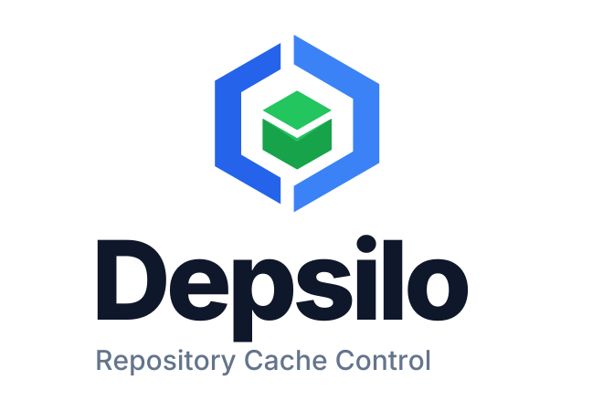
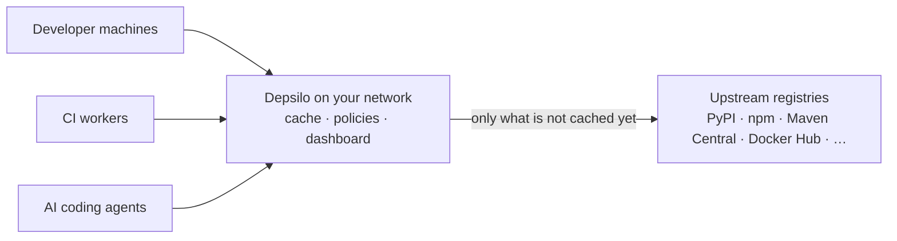

<div align="center">

<picture>
  <source media="(prefers-color-scheme: dark)" srcset="docs/brand/logo-stacked-dark.svg">
  <source media="(prefers-color-scheme: light)" srcset="docs/brand/logo-stacked-light.svg">
  
</picture>

**A self-hosted dependency cache for homelabs and small teams.**

Download each package once, then serve it to every developer machine and CI job
on your network. Keep using your existing package managers.

[](https://github.com/depsilo/depsilo/releases)
[](https://github.com/depsilo/depsilo/actions/workflows/verify.yml)
[](LICENSE)

[Quick start](#quick-start) &bull;
[Documentation](docs/README.md) &bull;
[Website](https://depsilo.com) &bull;
[中文](docs/README_zh.md)

</div>

## What it does

Without a shared cache, the same packages are downloaded from the internet over
and over: once on every developer machine, and again in every clean CI run and
container build.

Depsilo sits between your machines and the public registries. The first request
for a package fetches it and keeps a copy. Later requests, from any machine, are
served from that copy.



To connect a tool, you change where it downloads from. The built-in guide
writes the exact lines for your address and package manager, for example:

```bash
pip config set global.index-url https://depsilo.example.com/pypi/simple/
npm config set registry https://depsilo.example.com/npm/
```

## What you get

- **Download once, reuse across machines.** One cache for developers and CI,
  stored on local disk or S3.
- **See whether it is working.** The dashboard shows service health, cache hits,
  upstream traffic, and recent requests.
- **Control what gets installed.** Block known-malicious packages, and apply
  package rules, a minimum release age, and snapshots. Coverage varies by
  ecosystem; see [supply-chain controls](docs/supply-chain.md).
- **Let a coding agent do the setup.** The home page offers a ready-made prompt
  for Claude Code, Cursor, Copilot Chat, Codex, and similar agents. It asks the
  agent to show its plan and wait for your approval before editing.
  `depsilo init-agent` and MCP are [also available](docs/deployment.md#ai-coding-agents).
- **Use your team's login.** Sign in through OIDC providers or LDAP directories,
  with local accounts still available.
- **Extend it later.** Chain instances so one fills its cache through another
  ([cascade](docs/cascade.md)), or share compiler output between build machines
  ([ccache and sccache](docs/compile-cache.md), in Chinese).

Runs as a single binary or Docker container, backed by SQLite. MIT-licensed,
with no telemetry.

## Quick start

You need Docker. No repository checkout or configuration file is required.

### 1. Start Depsilo

```bash
docker run -d --name depsilo \
  -p 23333:23333 \
  -v depsilo-data:/root/.depsilo \
  --restart unless-stopped \
  ghcr.io/depsilo/depsilo:latest
```

`-p 23333:23333` publishes the port on every network interface of the host,
and package downloads need no sign-in, so run this on a network you trust. To
try Depsilo on one machine only, use `-p 127.0.0.1:23333:23333`.

### 2. Create your administrator

Print the bootstrap token:

```bash
docker exec depsilo depsilo setup token
```

Open **<http://127.0.0.1:23333>**, enter the token, and create your
administrator. There is no default administrator password.

### 3. Connect a client

Setup continues to **Connect a client**:

1. Choose your package manager.
2. Apply the generated configuration on the machine that will download
   dependencies.
3. Run the suggested download command, and confirm the request and cache
   results on the same page.

The guide writes its commands for the address in your browser. If the clients
are other machines, open Depsilo at the server's network address, for example
`http://<server-address>:23333`, and copy the commands from there. This needs
the port published beyond `127.0.0.1`, as `-p 23333:23333` in step 1 does.

The dashboard then shows the statistics. You can reopen the guide anytime, or
pick **AI setup** on the home page to hand the client configuration to a coding
agent.

For most ecosystems the default upstreams put a mainland-China mirror first and
the official registry second. To change them, open **Advanced settings** →
**Configure upstreams** on the setup page, or **Upstreams** in Admin later.

The `depsilo-data` volume preserves configuration, credentials, database, and
cache. Shortly after the first start Depsilo downloads the list of
known-malicious packages (a few hundred thousand entries) in the background;
the volume then holds roughly 150 MB before any package is cached. For an
ongoing deployment, pin a release tag instead of `latest` and keep the service
on a trusted network. Use a
[TLS reverse proxy](docs/deployment.md#reverse-proxy-and-tls) for remote access.

<details>
<summary>Prefer a binary? Linux / macOS</summary>

```bash
curl -fsSL https://depsilo.com/install.sh | bash
depsilo serve
```

Open <http://127.0.0.1:23333> and follow the same setup steps. The startup output
shows the bootstrap token; retrieve it again with `depsilo setup token` in
another terminal. The binary listens on `127.0.0.1` only; to serve other
machines, see [binary installation](docs/deployment.md#binary-installation).

If the installer download fails (`curl` reports an error such as 403), nothing
is installed. Download the archive for your platform from
[GitHub Releases](https://github.com/depsilo/depsilo/releases) instead, extract
it, and put `depsilo` on your `PATH`.

</details>

For Compose, custom ports, persistent directories, or upgrades, follow the
[deployment guide](docs/deployment.md). For background operation, see
[binary installation](docs/deployment.md#binary-installation).

## Supported clients

| Area | Clients and ecosystems |
| --- | --- |
| Python | pip, uv, Poetry, Pipenv, PDM |
| JavaScript | npm, pnpm, Yarn, Bun |
| JVM | Maven, Gradle, sbt |
| Other language packages | Go, Cargo, RubyGems / Bundler, Composer, NuGet |
| Linux and Kubernetes | APT, Alpine apk, Helm |
| Data and models | Conda, R / CRAN, Hugging Face |
| Container images | Docker / OCI pulls, including containerd and Podman |
| Compiler caches | ccache and sccache; [separate setup](docs/compile-cache.md) (in Chinese) |

Docker and Hugging Face need [additional setup](docs/deployment.md#optional-ecosystems).
A Node project whose lockfile was created against another registry needs a
[one-time lockfile change](docs/package-rules.md#node-lockfiles) before its
installs go through Depsilo.

## What it does not do

- **It does not host your own packages.** Depsilo caches what it fetches from
  upstream registries. There is no private publishing, and Docker support is a
  pull-through cache without image push.
- **It does not run as a cluster.** Each instance owns its database and
  configuration; shared-database HA is not supported. Independent instances can
  be chained with [cascade](docs/cascade.md).
- **It does not install into isolated networks yet.** Content that is already
  cached can still be served through some
  [upstream failures](docs/deployment.md#when-upstreams-are-unreachable), and
  signed dependency-set bundles can be
  [exported and imported](docs/distribution.md). Serving those bundles to
  package managers on a network without internet access is planned work.

See [product scope](PRODUCT.md) for the full capability boundaries.

## Find the next step

| I want to… | Guide |
| --- | --- |
| Deploy, back up, upgrade, or troubleshoot | [Deployment](docs/deployment.md) · [Back up and restore](docs/deployment.md#back-up-and-restore) · [Upgrade](docs/deployment.md#upgrade) · [Configuration reference](config.example.toml) |
| Script the first run or recover administrator access | [Scripted setup](docs/deployment.md#scripted-setup) · [Administrator access](docs/deployment.md#administrator-access) |
| Configure package policies | [Supply-chain controls](docs/supply-chain.md) · [Package rules](docs/package-rules.md) |
| Connect an identity provider or directory | [OIDC](docs/oidc.md) · [LDAP / LDAPS](docs/ldap.md) |
| Connect build machines or coding agents | [Compiler cache](docs/compile-cache.md) (in Chinese) · [AI agents / MCP](docs/deployment.md#ai-coding-agents) |
| Share caches between independent instances | [Cascade](docs/cascade.md) |
| Secure an instance or verify a release | [Security](SECURITY.md) · [Release verification](docs/release-verification.md) |

Browse the [documentation map](docs/README.md) for operations, APIs, and
architecture, or the [changelog](CHANGELOG.md) for release history.

## Contributing

Start with the [development quick start](docs/development/quick-start.md) and
[contribution guide](CONTRIBUTING.md). Coding agents should read [AGENTS.md](AGENTS.md).

## License

[MIT](LICENSE). This README describes the current `master` branch; for an
installed release, use the documentation bundled with that version.
