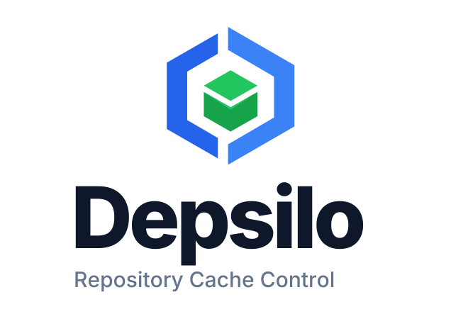

<div align="center">

<picture>
  <source media="(prefers-color-scheme: dark)" srcset="docs/brand/logo-stacked-dark.svg">
  <source media="(prefers-color-scheme: light)" srcset="docs/brand/logo-stacked-light.svg">
  
</picture>

**A self-hosted dependency cache for homelabs and small teams.**

Reuse package downloads, reduce upstream traffic, and apply supply-chain policies
through one service. Keep using your existing package managers.

[](https://github.com/depsilo/depsilo/releases)
[](https://github.com/depsilo/depsilo/actions/workflows/verify.yml)
[](LICENSE)

[Quick start](#quick-start) &bull;
[Documentation](docs/README.md) &bull;
[Website](https://depsilo.com) &bull;
[中文](docs/README_zh.md)

</div>

## Why Depsilo?

- **Download once, reuse across machines.** Cache dependencies for developers
  and CI, with local or S3-backed artifact storage.
- **See what is happening.** Monitor service health, cache hits, upstream traffic,
  and recent requests in the web dashboard.
- **Control what gets installed.** Apply malicious-package blocking, package
  rules, release-age policies, and snapshots. Coverage varies by ecosystem;
  see [supply-chain controls](docs/supply-chain.md).
- **Use your team's login.** Connect multiple OIDC or LDAP authentication sources
  and manage personal login bindings.

Runs as a single binary or Docker container, backed by SQLite. MIT-licensed,
with no telemetry.

## Quick start

### Start with Docker

No repository checkout or configuration file is needed for a new installation.

```bash
docker run -d --name depsilo \
  -p 23333:23333 \
  -v depsilo-data:/root/.depsilo \
  --restart unless-stopped \
  ghcr.io/depsilo/depsilo:latest
```

Once the service starts, retrieve the setup token:

```bash
docker exec depsilo depsilo setup token
```

1. Open **<http://127.0.0.1:23333>**, enter the token, and create your administrator.
   There is no default administrator password.
2. Open **Connect a client**, choose your package manager, and apply the generated
   configuration on the machine that will download dependencies.
3. Run the suggested download command and confirm the request and cache results
   on this page, then open the dashboard for statistics. You can reopen the guide anytime.

The volume preserves configuration, credentials, database, and cache. For an
ongoing deployment, pin a release tag instead of `latest` and keep the service
on a trusted network. Use a TLS reverse proxy for remote access.

<details>
<summary>Prefer a binary? Linux / macOS</summary>

```bash
curl -fsSL https://depsilo.com/install.sh | bash
depsilo serve
```

Open <http://127.0.0.1:23333> and follow the same setup steps. The startup output
shows the setup token; retrieve it again with `depsilo setup token` in another
terminal. You can also download a binary from
[GitHub Releases](https://github.com/depsilo/depsilo/releases).

</details>

For Compose, custom ports, persistent directories, or upgrades, follow the
[deployment guide](docs/deployment.md). For background operation, see
[binary installation](docs/deployment.md#binary-installation).

## Supported clients

| Area | Clients and ecosystems |
| --- | --- |
| Python | pip, uv, Poetry, Pipenv, PDM |
| JavaScript | npm, pnpm, Yarn, Bun |
| JVM | Maven, Gradle, sbt |
| Other language packages | Go, Cargo, RubyGems / Bundler, Composer, NuGet |
| Linux and Kubernetes | APT, Alpine apk, Helm |
| Data and models | Conda, R / CRAN, Hugging Face |
| Container images | Docker / OCI pulls, including containerd and Podman |
| Compiler caches | ccache and sccache; [separate setup](docs/compile-cache.md) |

Package traffic uses 14 ecosystem routes plus Docker's separate OCI route.
Docker and Hugging Face need [additional setup](docs/deployment.md#optional-ecosystems).
Docker support is a pull-through cache, without image push or hosted repositories.

Each instance owns its database and configuration; shared-database HA is not
supported. See [product scope](PRODUCT.md) for capability boundaries.

## Find the next step

| I want to… | Guide |
| --- | --- |
| Deploy, upgrade, or troubleshoot | [Deployment](docs/deployment.md) · [Configuration reference](config.example.toml) |
| Configure package policies | [Supply-chain controls](docs/supply-chain.md) · [Package rules](docs/package-rules.md) |
| Connect an identity provider or directory | [OIDC](docs/oidc.md) · [LDAP / LDAPS](docs/ldap.md) |
| Connect build machines or coding agents | [Compiler cache](docs/compile-cache.md) · [AI agents / MCP](docs/deployment.md#ai-coding-agents) |
| Share caches between independent instances | [Cascade](docs/cascade.md) |
| Secure an instance or verify a release | [Security](SECURITY.md) · [Release verification](docs/release-verification.md) |

Browse the [documentation map](docs/README.md) for operations, APIs, and
architecture, or the [changelog](CHANGELOG.md) for release history.

## Contributing

Start with the [development quick start](docs/development/quick-start.md) and
[contribution guide](CONTRIBUTING.md). Coding agents should read [AGENTS.md](AGENTS.md).

## License

[MIT](LICENSE). This README describes the current `master` branch; for an
installed release, use the documentation bundled with that version.
