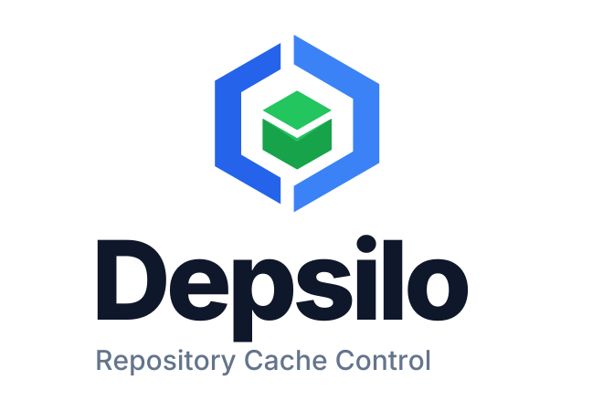
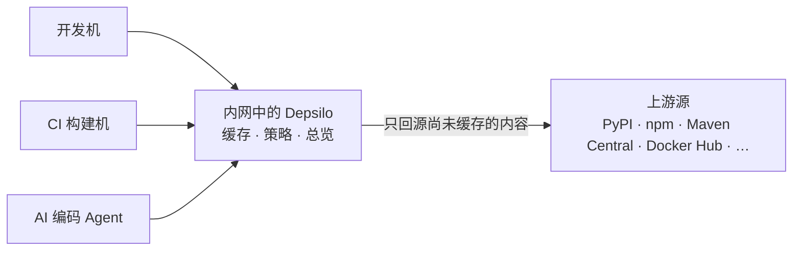

<div align="center">

<picture>
  <source media="(prefers-color-scheme: dark)" srcset="brand/logo-stacked-dark.svg">
  <source media="(prefers-color-scheme: light)" srcset="brand/logo-stacked-light.svg">
  
</picture>

**面向 homelab 和小团队的自托管依赖缓存服务。**

每个依赖包只下载一次，然后供内网里的每台开发机和每个 CI 任务复用。
继续使用你熟悉的包管理器。

[](https://github.com/depsilo/depsilo/releases)
[](https://github.com/depsilo/depsilo/actions/workflows/verify.yml)
[](../LICENSE)

[快速开始](#快速开始) &bull;
[文档](README.md) &bull;
[网站](https://depsilo.com) &bull;
[English](../README.md)

</div>

## 它做什么

没有共享缓存时，同样的依赖包会被反复从互联网下载：每台开发机下载一次，
每次干净的 CI 构建和容器镜像构建还要再下载一次。

Depsilo 部署在你的设备和公共上游源之间。某个包第一次被请求时，Depsilo 回源下载并保留一份；
之后无论哪台机器再请求，都直接从这份缓存返回。



接入一个工具，只需要修改它的下载地址。内置的接入指引会按你的服务地址和包管理器生成具体配置，例如：

```bash
pip config set global.index-url https://depsilo.example.com/pypi/simple/
npm config set registry https://depsilo.example.com/npm/
```

## 你能得到什么

- **一次下载，多台机器复用。** 开发者和 CI 共用一份缓存，存放在本地磁盘或 S3。
- **看清缓存是否有效。** 在总览中查看服务健康、缓存命中、回源流量和最近请求。
- **控制安装的内容。** 阻断已知恶意包，并支持包规则、最小发布年龄和快照。
  具体覆盖范围因生态而异，详见[供应链控制](supply-chain.md)。
- **把接入交给编码 Agent。** 首页提供现成的提示词，可用于 Claude Code、Cursor、
  Copilot Chat、Codex 等 Agent；提示词要求 Agent 先给出修改计划，等你确认后再动手。
  另有 `depsilo init-agent` 和 MCP 两种[接入方式](deployment.md#ai-coding-agents)。
- **接入团队的登录方式。** 通过 OIDC 身份提供方或 LDAP 目录登录，本地账号仍然可用。
- **需要时再扩展。** 让一个实例通过另一个实例回源并填充缓存（[级联缓存](cascade.md)），
  或在构建机之间共享编译产物（[ccache 与 sccache](compile-cache.md)）。

通过单个可执行文件或 Docker 容器运行，使用 SQLite，采用 MIT 许可证，不收集遥测。

## 快速开始

需要先安装 Docker。无需克隆仓库，也无需提前编写配置文件。

### 1. 启动 Depsilo

```bash
docker run -d --name depsilo \
  -p 23333:23333 \
  -v depsilo-data:/root/.depsilo \
  --restart unless-stopped \
  ghcr.io/depsilo/depsilo:latest
```

`-p 23333:23333` 会把端口发布到宿主机的所有网卡，而下载依赖包不需要登录，所以请在可信网络中运行。
只想在本机试用时，改用 `-p 127.0.0.1:23333:23333`。

### 2. 创建管理员

获取初始化令牌：

```bash
docker exec depsilo depsilo setup token
```

打开 **<http://127.0.0.1:23333>**，输入令牌并创建管理员。系统没有默认管理员密码。

### 3. 接入客户端

初始化完成后会进入 **接入客户端**：

1. 选择包管理器。
2. 在实际下载依赖的设备上应用生成的配置。
3. 运行建议的下载命令，在同一页面确认请求与缓存结果。

接入指引里的命令是按浏览器地址栏里的地址生成的。客户端在其他机器上时，请用服务器的网络地址打开 Depsilo
（例如 `http://<服务器地址>:23333`），再从那里复制命令。这要求端口没有只发布在 `127.0.0.1` 上，
第 1 步的 `-p 23333:23333` 即可。

之后可以在总览查看统计。接入指引可以随时重新打开；也可以在首页选择 **AI 接入**，
把客户端配置交给编码 Agent 完成。

多数生态的默认上游以中国大陆镜像（清华 TUNA、npmmirror、goproxy.cn 等）为首选、官方源为备用，
在国内网络下不必先找镜像、改配置。需要调整时，在初始化页面的 **高级设置** → **配置上游源** 中修改，
之后也可以在 Admin 的 **上游源** 页面修改。

`depsilo-data` 这个 Volume 会保留配置、凭据、数据库和缓存。首次启动后不久，Depsilo 会在后台下载已知恶意包名单
（数十万条），此时即使还没有缓存任何包，这个 Volume 也会占用约 150 MB。长期部署时，请用明确的发行版本替换 `latest`，
并将服务放在可信网络中；远程访问应通过[提供 TLS 的反向代理](deployment.md#reverse-proxy-and-tls)。

<details>
<summary>使用可执行文件安装（Linux / macOS）</summary>

```bash
curl -fsSL https://depsilo.com/install.sh | bash
depsilo serve
```

打开 <http://127.0.0.1:23333>，按上面的步骤完成初始化。启动输出会显示初始化令牌；
也可以在另一终端运行 `depsilo setup token` 再次获取。
可执行文件默认只监听 `127.0.0.1`；要让其他机器访问，见[可执行文件安装](deployment.md#binary-installation)。

如果安装脚本下载失败（`curl` 报错，例如 403），不会安装任何内容。
请改从 [GitHub Releases](https://github.com/depsilo/depsilo/releases) 下载对应平台的压缩包，解压后把 `depsilo` 放到 `PATH` 中。

</details>

Compose、自定义端口、持久化目录和升级方式见[部署指南](deployment.md)；
后台运行方式见[可执行文件安装](deployment.md#binary-installation)。

## 支持的客户端

| 类别 | 客户端与生态 |
| --- | --- |
| Python | pip、uv、Poetry、Pipenv、PDM |
| JavaScript | npm、pnpm、Yarn、Bun |
| JVM | Maven、Gradle、sbt |
| 其他语言包 | Go、Cargo、RubyGems / Bundler、Composer、NuGet |
| Linux 与 Kubernetes | APT、Alpine apk、Helm |
| 数据与模型 | Conda、R / CRAN、Hugging Face |
| 容器镜像 | Docker / OCI 拉取，包括 containerd 和 Podman |
| 编译缓存 | ccache、sccache，需[单独配置](compile-cache.md) |

Docker 与 Hugging Face 需要[额外配置](deployment.md#optional-ecosystems)。
lockfile 是对着其他源生成的 Node 项目，需要先对 lockfile 做[一次性调整](package-rules.md#node-lockfiles)，安装才会经过 Depsilo。

## 它不做什么

- **不托管你自己的包。** Depsilo 缓存的是从上游源取回的内容，不提供私有包发布；
  Docker 仅支持拉取缓存，不支持镜像推送。
- **不以集群方式运行。** 每个实例独立管理数据库与配置，不支持共享数据库的高可用部署。
  多个独立实例可以通过[级联缓存](cascade.md)串联。
- **暂不支持向隔离网络安装依赖。** 已缓存的内容在部分[上游故障](deployment.md#when-upstreams-are-unreachable)期间仍可提供，
  签名的依赖集传输包也已经可以[导出和导入](distribution.md)；
  但在无法访问互联网的网络中把这些内容提供给包管理器，仍在计划中。

完整能力边界见[产品说明](../PRODUCT.md)。

## 接下来做什么

| 目标 | 指南 |
| --- | --- |
| 部署、备份、升级或排查问题 | [部署指南](deployment.md) · [备份与恢复](deployment.md#back-up-and-restore) · [升级](deployment.md#upgrade) · [配置参考](../config.example.toml) |
| 用脚本完成首次初始化，或重置管理员密码 | [脚本化初始化](deployment.md#scripted-setup) · [找回管理员权限](deployment.md#administrator-access) |
| 配置依赖策略 | [供应链控制](supply-chain.md) · [包规则](package-rules.md) |
| 接入身份提供方或用户目录 | [OIDC](oidc.md) · [LDAP / LDAPS](ldap.md) |
| 接入构建机器或编码 Agent | [编译缓存](compile-cache.md) · [AI Agent / MCP](deployment.md#ai-coding-agents) |
| 在独立实例之间共享缓存 | [级联缓存](cascade.md) |
| 保护实例或验证发行产物 | [安全](../SECURITY.md) · [发行验证](release-verification.md) |

运维、API 和架构文档见[文档地图](README.md)；版本变化见[更新日志](../CHANGELOG.md)。

## 参与贡献

从[开发快速开始](development/quick-start.md)和[贡献指南](../CONTRIBUTING.md)开始。
编码 Agent 请先阅读 [AGENTS.md](../AGENTS.md)。

## 许可证

[MIT](../LICENSE)。本 README 描述当前 `master` 分支；使用已发布版本时，请以该版本附带的文档为准。
