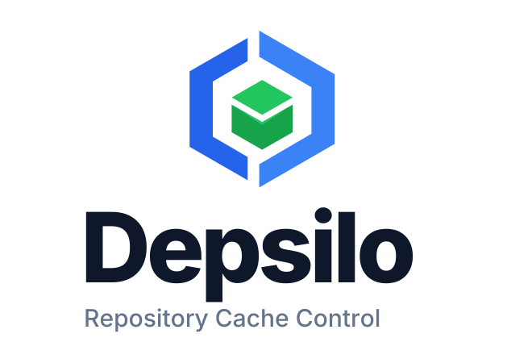

<div align="center">

<picture>
  <source media="(prefers-color-scheme: dark)" srcset="brand/logo-stacked-dark.svg">
  <source media="(prefers-color-scheme: light)" srcset="brand/logo-stacked-light.svg">
  
</picture>

**面向 homelab 和小团队的自托管依赖缓存服务。**

用一个服务复用依赖下载、减少回源流量，并执行供应链策略。
继续使用你熟悉的包管理器。

[](https://github.com/depsilo/depsilo/releases)
[](https://github.com/depsilo/depsilo/actions/workflows/verify.yml)
[](../LICENSE)

[快速开始](#快速开始) &bull;
[文档](README.md) &bull;
[网站](https://depsilo.com) &bull;
[English](../README.md)

</div>

## 为什么使用 Depsilo？

- **一次下载，多台机器复用。** 为开发者和 CI 缓存依赖制品，支持本地或 S3 存储。
- **看清缓存是否有效。** 在总览中查看服务健康、缓存命中、回源流量和最近请求。
- **控制安装的内容。** 支持恶意包阻断、包规则、最小发布年龄和快照。
  具体覆盖范围因生态而异，详见[供应链控制](supply-chain.md)。
- **接入团队的登录方式。** 支持多个 OIDC 或 LDAP 认证源，以及个人登录方式的绑定管理。

通过单个可执行文件或 Docker 容器运行，使用 SQLite，采用 MIT 许可证，不收集遥测。

## 快速开始

### 使用 Docker 启动

新安装无需克隆仓库，也无需提前编写配置文件。

```bash
docker run -d --name depsilo \
  -p 23333:23333 \
  -v depsilo-data:/root/.depsilo \
  --restart unless-stopped \
  ghcr.io/depsilo/depsilo:latest
```

服务启动后，获取初始化令牌：

```bash
docker exec depsilo depsilo setup token
```

1. 打开 **<http://127.0.0.1:23333>**，输入令牌并创建管理员。系统没有默认管理员密码。
2. 进入 **接入客户端**，选择包管理器，在实际下载依赖的设备上应用生成的配置。
3. 运行建议的下载命令，在当前页面确认请求与缓存结果，再前往总览查看统计。以后可以随时重新打开接入指引。

Volume 会保留配置、凭据、数据库和缓存。长期部署时，请用明确的发行版本替换 `latest`，
并将服务放在可信网络中；远程访问应通过提供 TLS 的反向代理。

<details>
<summary>使用可执行文件安装（Linux / macOS）</summary>

```bash
curl -fsSL https://depsilo.com/install.sh | bash
depsilo serve
```

打开 <http://127.0.0.1:23333>，按上面的步骤完成初始化。启动输出会显示初始化令牌；
也可以在另一终端运行 `depsilo setup token` 再次获取。
还可以从 [GitHub Releases](https://github.com/depsilo/depsilo/releases) 下载对应平台的安装包。

</details>

Compose、自定义端口、持久化目录和升级方式见[部署指南](deployment.md)；
后台运行方式见[可执行文件安装](deployment.md#binary-installation)。

## 支持的客户端

| 类别 | 客户端与生态 |
| --- | --- |
| Python | pip、uv、Poetry、Pipenv、PDM |
| JavaScript | npm、pnpm、Yarn、Bun |
| JVM | Maven、Gradle、sbt |
| 其他语言包 | Go、Cargo、RubyGems / Bundler、Composer、NuGet |
| Linux 与 Kubernetes | APT、Alpine apk、Helm |
| 数据与模型 | Conda、R / CRAN、Hugging Face |
| 容器镜像 | Docker / OCI 拉取，包括 containerd 和 Podman |
| 编译缓存 | ccache、sccache，需[单独配置](compile-cache.md) |

包请求通过 14 个生态路由和独立的 Docker OCI 路由接入。
Docker 与 Hugging Face 需要[额外配置](deployment.md#optional-ecosystems)。
Docker 支持拉取缓存，不提供镜像推送或托管仓库。

每个实例独立管理数据库与配置，不支持共享数据库的高可用部署。
完整能力边界见[产品说明](../PRODUCT.md)。

## 接下来做什么

| 目标 | 指南 |
| --- | --- |
| 部署、升级或排查问题 | [部署指南](deployment.md) · [配置参考](../config.example.toml) |
| 配置依赖策略 | [供应链控制](supply-chain.md) · [包规则](package-rules.md) |
| 接入身份提供方或用户目录 | [OIDC](oidc.md) · [LDAP / LDAPS](ldap.md) |
| 接入构建机器或编码 Agent | [编译缓存](compile-cache.md) · [AI Agent / MCP](deployment.md#ai-coding-agents) |
| 在独立实例之间共享缓存 | [级联缓存](cascade.md) |
| 保护实例或验证发行产物 | [安全](../SECURITY.md) · [发行验证](release-verification.md) |

运维、API 和架构文档见[文档地图](README.md)；版本变化见[更新日志](../CHANGELOG.md)。

## 参与贡献

从[开发快速开始](development/quick-start.md)和[贡献指南](../CONTRIBUTING.md)开始。
编码 Agent 请先阅读 [AGENTS.md](../AGENTS.md)。

## 许可证

[MIT](../LICENSE)。本 README 描述当前 `master` 分支；使用已发布版本时，请以该版本附带的文档为准。
